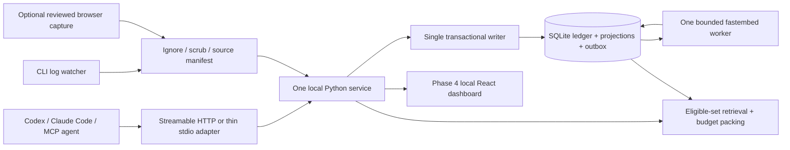

# Local-first AI memory engine — implementation blueprint

Phase 1 research completed 2026-11-17. The user authorized sequential Phase 2 implementation on 2026-11-18. This remains the target blueprint synthesized from four research passes; see [implementation tasks](docs/plans/2026-11-18-phase-2.md) for verified progress. Tasks 1–3 now provide package/configuration, SQLite bootstrap/migration, Git project resolution and strict contract/privacy helpers; MCP, memory-write/retrieval logic and browser capture are not implemented yet.

## Decisions and evidence

| Research pass | Established evidence | Limits carried into this blueprint |
| --- | --- | --- |
| [1: stack/schema](research/01-stack-and-schema.md) | Nessie native macOS bundle, relational graph, content slices, FTS5, vec0 and revision declarations | No embedding model/provider, bi-temporal or ranking guarantee established |
| [2: sync](research/02-sync-pipeline.md) | Provider fetcher/parser names, discovery cache schema, cooldown/reauthentication and WebKit metadata | Authentication selection, cursor control flow and duplicate-free import unverified |
| [3: context engine](research/03-context-engine.md) | Context/revision metadata; pinned public Mem0 and Graphiti comparison | No Nessie prompts or consolidation algorithm recovered; public model-assisted pipelines are not our required runtime |
| [4: MCP/retrieval](research/04-mcp-and-retrieval.md) | Search/MCP-client metadata and shipped name/parameter labels | No confirmed live Nessie tool catalog, schemas, RRF or token budget |

Research was read-only and metadata-only. No personal conversation rows, live prompts, credentials, cookies or session tokens were queried. No proprietary implementation code was copied. The designs below are our own. Mem0's pinned source contains both ADD/UPDATE/DELETE/NONE policy definitions and a newer additive ingestion path. Graphiti supplies a temporal relationship pattern; its mutable edge fields and model-assisted resolution do not supply our append-only implementation.

The baseline is an **8GB unified-memory Apple Silicon MacBook**, superseding the earlier 16–32GB / 7B+ assumption. Default writes come from connected agents via `record_memory`; there is no mandatory generative model, paid extraction API, external memory backend or cloud vector database. All storage/indexing, embedding inference, ranking and MCP serving run locally. Optional cloud-chat import contacts an existing account only through an explicitly paired companion. The connected agent retains its own resource/billing implications.

## Process architecture and ownership



FastAPI hosts local API and the Python MCP SDK's `/mcp` Streamable HTTP application. Thin stdio adapters forward protocol messages and never load ONNX or own database writers. SDK/protocol versions must be pinned during implementation against the actual testbeds. Modern HTTP may stream SSE within MCP; legacy standalone HTTP+SSE is deferred unless a client needs it. The [MCP transport specification](https://modelcontextprotocol.io/specification/2025-11-25/basic/transports) defines framing and local Host/Origin/authentication requirements.

One service process, one Uvicorn worker, one embedding session and one inference at a time initially. A bounded writer queue serializes updates; inference and filesystem/network reads happen outside writer transactions. Reads use short bounded snapshots. Long history queries have deadlines so they cannot hold WAL checkpoints indefinitely. A per-user service lock and bound-port ownership prevent duplicate engine instances; clients fail clearly or connect to the existing service rather than launch extra model copies.

## Project resolution and permissions

1. For an authorized local cwd, resolve the Git root and canonical absolute common directory using `git rev-parse --git-common-dir` and filesystem canonicalization. Worktrees share its alias. Do not scan arbitrary unapproved roots or execute repo hooks.
2. Normalize remote origin conservatively: remove credentials, normalize host/default port and known SSH/HTTPS equivalences, remove terminal `.git` where appropriate, preserve case-sensitive repository paths and nondefault ports. Do not print raw origin values before sanitizing. Different protocols/hosts are equivalent only under explicit supported rules.
3. Reuse a matching common-directory alias first; reconcile a normalized remote alias to group multiple clones. If aliases disagree, stop automatic resolution and require an explicit project mapping; never silently merge historical projects. A remote change does not automatically migrate past memories.
4. Without origin, use persisted common-directory identity; without Git, use the `global` namespace. Remote-only bridge sessions must be explicitly mapped to an existing project, not assigned from free-form chat titles.
5. Every request names project IDs. Additional namespaces, including `global`, require explicit opt-in and principal authorization. Cross-project edges do not grant retrieval access. Logical namespaces prevent accidental bleed, not OS-level access by another process with the same user's database permissions.

Provision projects through the local admin CLI before tool writes. Planned `memory project resolve --cwd <authorized-path>` returns `{project_id, resolution, needs_review}` with no secret remote fields; this CLI is administrative, not an extra MCP tool. Default file/db mode is user-only. Review authorization is a separate capability from structured-write authorization; ordinary agent writes cannot self-approve a conflict.

## Contracts and API surface

[Pass 4 Section 4](research/04-mcp-and-retrieval.md#4-original-mcp-server--token-budgeted-retrieval-layer) documents the **draft-2020-12 JSON Schema registry**, now packaged unchanged as `src/brain/contracts/v1.json`, including every required field, enum, bound, nested object and success/error envelope. Export each tool's Input/Output with local `$defs` included. No network schema resolution, unknown keys, implicit defaults, type coercion or nonfinite JSON values.

| Interface | Input → output | Semantics |
| --- | --- | --- |
| `get_project_context` | `get_project_contextInput` → Output | Snapshot-scoped accepted context; goal is nullable; deterministic priorities without goal |
| `search_memory` | `search_memoryInput` → Output | Query/exact-key/type filters plus project/world/knowledge scope and budget |
| `record_memory` | `record_memoryInput` → Output | Typed proposal, provenance, applicability, expected revision and idempotency; durable ack |
| `resolve_conflict` | `resolve_conflictInput` → Output | Review-only keep/accept/coexist with conflict-head compare-and-swap |
| `get_history` | `get_historyInput` → Output | Increasing immutable-event summaries with pinned upper sequence and budgeted continuation |
| `POST /ingest` | `ingestInput` → Output | Paired bridge source manifests and optional structured records; no raw transcript body |

`save_memory` is superseded by `record_memory`; no alias is required in v1. MCP advertises the five tools with inputSchema/outputSchema and read-only annotations for read tools, while authorization remains enforced independently. `record_memory` and conflict resolution are not read-only. Application errors use the strict Error envelope; protocol errors remain JSON-RPC errors.

FastAPI exposes `POST /v1/tools/{name}` for the same five names with exactly the same business schemas, plus `/ingest` and `/mcp`. Internal admin-only `GET /health` returns `{status:"ready"|"degraded", schema_version:1, semantic:"ready"|"disabled"|"lagging"}`; it exposes no paths/source data and is outside model context. HTTP mappings: 400 validation/budget, 401/403 auth, 404 scoped absence, 409 version/idempotency/transition, 413 body limit, 429 queue pressure, 503 unavailability. Disable framework validation echoes, add no-store, and log only bounded codes/IDs.

Bind to loopback, validate Host and Origin, require local credentials, and restrict companion pairing to explicit extension origins and write-only adapter/project scopes. Engine/companion credentials never enter SQLite provenance, query strings or logs. MCP session IDs are not authentication. Credentials are local infrastructure artifacts, not cloud dependencies. No wildcard CORS or arbitrary URL-fetch endpoint.

## Typed consolidation and ledger semantics

Typed payloads cover Decision (choice/rationale), Constraint (operator/value), TechStack (technology/version), TaskState (stable task ID/state/transition) and BugFix (issue/symptom/cause/fix/verification). Explicit entity/key/applicability scope and cardinality distinguish single-valued versus set-valued assertions. Task/issue identity must match structured entity identity. Prose stays sanitized and meaningful; normalize conservatively without stripping negation, units or identifier case.

Exact idempotency and stable structured identity lead. Exact sanitized hashes detect identical claims; a new source can append support, while replay returns the original logical ack. Union exact-key, FTS overlap and vector candidates only within project/type/time scope. Similarity nominates candidates, never proves equivalence or contradiction. No universal similarity threshold is hard-coded as evidence; configurable per-type/generation thresholds need synthetic calibration.

TaskState auto-updates require stable identity, explicit ordering, allowed transition and expected revision; reopening requires explicit `reopen`. Arrival order cannot replace effective event order. Conflicting Decisions/Constraints always enter `pending_review`; other facts supersede automatically only with explicit unambiguous replacement evidence. Pending candidates never replace accepted retrieval state. Incompatible statement/payload or interval ambiguity requires rejection/review. Unknown valid times remain explicit and are excluded from default world-time search with a diagnostic; they remain in history/review.

Authoritative revisions and events are immutable. `valid_from`/`valid_to` describe half-open world-time intervals; `recorded_at` and server ledger sequence describe knowledge order. Closing an interval appends an effective-boundary event; it does not update the original revision. Accepted segments are projections with both valid and knowledge intervals. A read at (V,K) derives only events known by K and selects intervals covering V. Future effective supersessions leave presently applicable facts active. Backdated corrections cannot alter an earlier knowledge-cutoff answer. Zero/reversed intervals and an end without a start are invalid.

Rollback is an explicit review/admin operation: planned `memory rollback --project ID --memory ID --revision ID --effective-at TIME --expected-revision ID --request-key ID` appends a restoring revision/event. It never deletes history and uses the same conflict/version rules. Phase 3 will expose its final CLI contract; it is not an unlisted callable MCP tool. History summaries are convenient output, not a sufficient audit backup by themselves.

One transaction revalidates expected heads, appends assertion/support/conflict/relation events, writes an idempotency receipt, updates immediate projections, and enqueues bounded indexing work with ingestion progress. Outbox rows contain revision/source references, not raw transcript payloads. Semantic jobs recheck generation and revision validity on completion. Projection failure rolls back the transaction. Embedding failure leaves durable facts and lexical retrieval available; it cannot silently roll back a committed fact.

## SQLite DDL for the first implementation

The following is original baseline DDL. Use a pinned SQLite build with STRICT tables, FTS5 and JSON functions, plus a pinned sqlite-vec extension for scalar cosine search. No custom cloud database or mandatory vector daemon. Initialization can create the database and operate lexical-only if sqlite-vec/model files are absent; semantic calls must then report degradation.

The blob table uses sqlite-vec scalar distance functions rather than vec0 in v1 because arbitrary eligible historical sets need correct filtering before top-k. A vec0 optimization is optional after version-specific filtered-query tests. BGE-small defaults to 384 float32 dimensions (1536 bytes per revision before indexes/overhead); model/artifact and normalizer generations are explicit. Do not mix embeddings or copy Nessie's 3072-dimensional choice. Validate finite float values and dimension agreement with embedding_generation in the writer; SQL length alone is insufficient.

Times are canonical UTC RFC3339 Z strings of one fixed precision (microseconds) so lexical order matches time. Input timestamps are parsed, normalized and validated, not compared as unnormalized strings. SQLite CHECKs are a second line of defense. Cross-table acceptance/cardinality, causal ordering, strict details_json event variants and polymorphic relation targets require writer validation and meaningful invariant tests. The DDL is a blueprint, not a claim that SQL alone enforces every policy.

```sql
PRAGMA foreign_keys = ON;
PRAGMA recursive_triggers = ON;
PRAGMA journal_mode = WAL;
PRAGMA busy_timeout = 3000;
PRAGMA synchronous = FULL;
PRAGMA cache_size = -8192;

CREATE TABLE project (
 id TEXT PRIMARY KEY, created_at TEXT NOT NULL,
 label TEXT NOT NULL CHECK(length(label) BETWEEN 1 AND 160)
) STRICT;
CREATE TABLE project_alias (
 kind TEXT NOT NULL CHECK(kind IN ('common_dir','remote','explicit')),
 identity TEXT NOT NULL, project_id TEXT NOT NULL REFERENCES project(id),
 created_at TEXT NOT NULL, PRIMARY KEY(kind,identity)
) STRICT;
CREATE TABLE source_ref (
 id TEXT PRIMARY KEY, project_id TEXT NOT NULL REFERENCES project(id),
 source_tool TEXT NOT NULL, source_agent TEXT, session_id TEXT NOT NULL,
 source_timestamp TEXT NOT NULL, anchor TEXT NOT NULL CHECK(length(anchor) BETWEEN 1 AND 160),
 locator TEXT CHECK(locator IS NULL OR length(locator)<=512),
 source_id TEXT NOT NULL, source_revision TEXT NOT NULL,
 sanitized_digest TEXT NOT NULL CHECK(length(sanitized_digest)=64),
 parser_generation TEXT NOT NULL,
 UNIQUE(project_id,source_tool,session_id,source_id,source_revision,parser_generation),
 UNIQUE(project_id,id)
) STRICT;
CREATE TABLE memory (
 id TEXT PRIMARY KEY, project_id TEXT NOT NULL REFERENCES project(id),
 entity_key TEXT NOT NULL, fact_key TEXT NOT NULL, applicability_scope TEXT NOT NULL,
 kind TEXT NOT NULL CHECK(kind IN ('Decision','Constraint','TechStack','TaskState','BugFix')),
 cardinality TEXT NOT NULL CHECK(cardinality IN ('single','set')),
 created_at TEXT NOT NULL, UNIQUE(project_id,id)
) STRICT;
CREATE INDEX memory_key ON memory(project_id,entity_key,fact_key,applicability_scope,kind);
-- Different assertions may intentionally share a key; acceptance rules govern coexistence.
CREATE TABLE memory_revision (
 id TEXT PRIMARY KEY, project_id TEXT NOT NULL, memory_id TEXT NOT NULL,
 version INTEGER NOT NULL CHECK(version>0),
 statement TEXT NOT NULL CHECK(length(statement) BETWEEN 1 AND 2000),
 typed_json TEXT NOT NULL CHECK(json_valid(typed_json)),
 normalized_hash TEXT NOT NULL CHECK(length(normalized_hash)=64),
 normalizer_generation TEXT NOT NULL,
 valid_from TEXT, valid_to TEXT, recorded_at TEXT NOT NULL,
 source_ref_id TEXT NOT NULL,
 CHECK(valid_to IS NULL OR (valid_from IS NOT NULL AND valid_to>valid_from)),
 FOREIGN KEY(project_id,memory_id) REFERENCES memory(project_id,id),
 FOREIGN KEY(project_id,source_ref_id) REFERENCES source_ref(project_id,id),
 UNIQUE(memory_id,version), UNIQUE(project_id,id), UNIQUE(project_id,memory_id,id)
) STRICT;
CREATE TABLE ledger_event (
 seq INTEGER PRIMARY KEY AUTOINCREMENT,
 project_id TEXT NOT NULL, memory_id TEXT NOT NULL, revision_id TEXT NOT NULL,
 event TEXT NOT NULL CHECK(event IN ('assert','accept','support','close','supersede','conflict_open','conflict_resolve','retract','restore')),
 effective_at TEXT, recorded_at TEXT NOT NULL, principal_id TEXT NOT NULL,
 source_ref_id TEXT, related_revision_id TEXT, conflict_id TEXT,
 details_json TEXT NOT NULL CHECK(json_valid(details_json)),
 summary TEXT NOT NULL CHECK(length(summary) BETWEEN 1 AND 1000),
 FOREIGN KEY(project_id,memory_id,revision_id) REFERENCES memory_revision(project_id,memory_id,id),
 FOREIGN KEY(project_id,related_revision_id) REFERENCES memory_revision(project_id,id),
 FOREIGN KEY(project_id,source_ref_id) REFERENCES source_ref(project_id,id)
) STRICT;
CREATE INDEX ledger_memory ON ledger_event(project_id,memory_id,seq);
CREATE INDEX ledger_conflict ON ledger_event(project_id,conflict_id,seq);
CREATE TABLE relation_event (
 id TEXT PRIMARY KEY, seq INTEGER NOT NULL REFERENCES ledger_event(seq),
 project_id TEXT NOT NULL REFERENCES project(id),
 from_revision_id TEXT NOT NULL,
 relation TEXT NOT NULL CHECK(relation IN ('belongs_to_project','supported_by','about_entity','supersedes','conflicts_with','references_project')),
 target_kind TEXT NOT NULL CHECK(target_kind IN ('project','source','entity','revision')),
 target_id TEXT NOT NULL, action TEXT NOT NULL CHECK(action IN ('assert','retract')),
 FOREIGN KEY(project_id,from_revision_id) REFERENCES memory_revision(project_id,id)
) STRICT;
-- Polymorphic targets and cross-project opt-in are validated inside the writer transaction.
CREATE TABLE idempotency_receipt (
 project_id TEXT NOT NULL REFERENCES project(id), principal_id TEXT NOT NULL,
 operation TEXT NOT NULL CHECK(operation IN ('record_memory','resolve_conflict','ingest','rollback')),
 request_key TEXT NOT NULL, request_hash TEXT NOT NULL CHECK(length(request_hash)=64),
 response_json TEXT NOT NULL CHECK(json_valid(response_json)), created_at TEXT NOT NULL,
 PRIMARY KEY(project_id,principal_id,operation,request_key)
) STRICT;

-- Rebuildable projections start here; these can be updated/deleted.
CREATE TABLE accepted_segment (
 id INTEGER PRIMARY KEY, project_id TEXT NOT NULL, memory_id TEXT NOT NULL,
 revision_id TEXT NOT NULL, valid_from TEXT, valid_to TEXT,
 known_from_seq INTEGER NOT NULL REFERENCES ledger_event(seq),
 known_to_seq INTEGER REFERENCES ledger_event(seq),
 CHECK(valid_to IS NULL OR (valid_from IS NOT NULL AND valid_to>valid_from)),
 CHECK(known_to_seq IS NULL OR known_to_seq>known_from_seq),
 FOREIGN KEY(project_id,memory_id,revision_id) REFERENCES memory_revision(project_id,memory_id,id)
) STRICT;
CREATE INDEX accepted_scope ON accepted_segment(project_id,known_from_seq,known_to_seq,valid_from,valid_to);
CREATE INDEX accepted_memory ON accepted_segment(project_id,memory_id,revision_id);
CREATE TABLE conflict_head (
 id TEXT PRIMARY KEY, project_id TEXT NOT NULL,
 memory_id TEXT NOT NULL, accepted_revision_id TEXT NOT NULL, candidate_revision_id TEXT NOT NULL,
 opened_seq INTEGER NOT NULL REFERENCES ledger_event(seq),
 head_seq INTEGER NOT NULL REFERENCES ledger_event(seq),
 status TEXT NOT NULL CHECK(status IN ('pending_review','resolved')),
 FOREIGN KEY(project_id,memory_id,accepted_revision_id) REFERENCES memory_revision(project_id,memory_id,id),
 FOREIGN KEY(project_id,candidate_revision_id) REFERENCES memory_revision(project_id,id)
) STRICT;
CREATE INDEX conflict_pending ON conflict_head(project_id,status,memory_id);
CREATE TABLE search_doc (
 id INTEGER PRIMARY KEY, project_id TEXT NOT NULL, revision_id TEXT NOT NULL,
 statement TEXT NOT NULL, identity_text TEXT NOT NULL,
 FOREIGN KEY(project_id,revision_id) REFERENCES memory_revision(project_id,id),
 UNIQUE(revision_id)
) STRICT;
CREATE VIRTUAL TABLE search_fts USING fts5(statement,identity_text,content='search_doc',content_rowid='id',tokenize='unicode61');
CREATE TRIGGER search_ai AFTER INSERT ON search_doc BEGIN
 INSERT INTO search_fts(rowid,statement,identity_text) VALUES(new.id,new.statement,new.identity_text);
END;
CREATE TRIGGER search_ad AFTER DELETE ON search_doc BEGIN
 INSERT INTO search_fts(search_fts,rowid,statement,identity_text) VALUES('delete',old.id,old.statement,old.identity_text);
END;
CREATE TRIGGER search_au AFTER UPDATE ON search_doc BEGIN
 INSERT INTO search_fts(search_fts,rowid,statement,identity_text) VALUES('delete',old.id,old.statement,old.identity_text);
 INSERT INTO search_fts(rowid,statement,identity_text) VALUES(new.id,new.statement,new.identity_text);
END;
CREATE TABLE embedding_generation (
 id TEXT PRIMARY KEY, model TEXT NOT NULL, artifact_digest TEXT NOT NULL,
 dimensions INTEGER NOT NULL CHECK(dimensions>0),
 normalization TEXT NOT NULL, tokenizer_digest TEXT NOT NULL,
 enabled INTEGER NOT NULL CHECK(enabled IN (0,1))
) STRICT;
CREATE TABLE revision_embedding (
 project_id TEXT NOT NULL, revision_id TEXT NOT NULL,
 generation_id TEXT NOT NULL REFERENCES embedding_generation(id),
 dimensions INTEGER NOT NULL CHECK(dimensions>0), embedding BLOB NOT NULL,
 CHECK(length(embedding)=dimensions*4),
 FOREIGN KEY(project_id,revision_id) REFERENCES memory_revision(project_id,id),
 PRIMARY KEY(revision_id,generation_id)
) STRICT;
CREATE INDEX embedding_project ON revision_embedding(project_id,generation_id,revision_id);
CREATE TABLE ingest_checkpoint (
 project_id TEXT NOT NULL REFERENCES project(id), adapter_id TEXT NOT NULL,
 source_handle TEXT NOT NULL, local_checkpoint TEXT NOT NULL,
 generation TEXT NOT NULL, updated_at TEXT NOT NULL,
 PRIMARY KEY(project_id,adapter_id,source_handle)
) STRICT;
CREATE TABLE work_item (
 id INTEGER PRIMARY KEY, project_id TEXT NOT NULL REFERENCES project(id),
 kind TEXT NOT NULL CHECK(kind IN ('embed','needs_agent','source_unavailable')),
 revision_id TEXT, source_ref_id TEXT, generation_id TEXT,
 dedup_key TEXT NOT NULL UNIQUE,
 state TEXT NOT NULL CHECK(state IN ('pending','leased','done','failed')),
 attempts INTEGER NOT NULL DEFAULT 0 CHECK(attempts>=0),
 not_before TEXT NOT NULL, lease_until TEXT,
 FOREIGN KEY(project_id,revision_id) REFERENCES memory_revision(project_id,id),
 FOREIGN KEY(project_id,source_ref_id) REFERENCES source_ref(project_id,id),
 FOREIGN KEY(generation_id) REFERENCES embedding_generation(id),
 CHECK((kind='embed' AND revision_id IS NOT NULL AND generation_id IS NOT NULL)
    OR (kind IN ('needs_agent','source_unavailable') AND source_ref_id IS NOT NULL))
) STRICT;
CREATE INDEX work_ready ON work_item(state,not_before,id);
CREATE TABLE integration_state (
 project_id TEXT NOT NULL REFERENCES project(id), adapter_id TEXT NOT NULL,
 status TEXT NOT NULL CHECK(status IN ('disabled','ready','syncing','cooldown','pending_reauth','error')),
 cooling_down_until TEXT, needs_reauth INTEGER NOT NULL CHECK(needs_reauth IN (0,1)),
 local_session_handle TEXT, last_success_at TEXT,
 PRIMARY KEY(project_id,adapter_id)
) STRICT;
CREATE TABLE file_discovery (
 project_id TEXT NOT NULL REFERENCES project(id), adapter_id TEXT NOT NULL,
 authorized_locator TEXT NOT NULL, file_generation TEXT NOT NULL,
 inode INTEGER, byte_size INTEGER NOT NULL CHECK(byte_size>=0),
 mtime_ns INTEGER, committed_offset INTEGER NOT NULL CHECK(committed_offset>=0),
 parser_generation TEXT NOT NULL, sanitized_digest TEXT,
 extraction_state TEXT NOT NULL CHECK(extraction_state IN ('discovered','needs_agent','recorded','unavailable')),
 PRIMARY KEY(project_id,adapter_id,authorized_locator)
) STRICT;
CREATE TRIGGER immutable_project_update BEFORE UPDATE ON project
BEGIN SELECT RAISE(ABORT,'append-only authority'); END;
CREATE TRIGGER immutable_project_delete BEFORE DELETE ON project
BEGIN SELECT RAISE(ABORT,'append-only authority'); END;
CREATE TRIGGER immutable_project_alias_update BEFORE UPDATE ON project_alias
BEGIN SELECT RAISE(ABORT,'append-only authority'); END;
CREATE TRIGGER immutable_project_alias_delete BEFORE DELETE ON project_alias
BEGIN SELECT RAISE(ABORT,'append-only authority'); END;
CREATE TRIGGER immutable_source_ref_update BEFORE UPDATE ON source_ref
BEGIN SELECT RAISE(ABORT,'append-only authority'); END;
CREATE TRIGGER immutable_source_ref_delete BEFORE DELETE ON source_ref
BEGIN SELECT RAISE(ABORT,'append-only authority'); END;
CREATE TRIGGER immutable_memory_update BEFORE UPDATE ON memory
BEGIN SELECT RAISE(ABORT,'append-only authority'); END;
CREATE TRIGGER immutable_memory_delete BEFORE DELETE ON memory
BEGIN SELECT RAISE(ABORT,'append-only authority'); END;
CREATE TRIGGER immutable_memory_revision_update BEFORE UPDATE ON memory_revision
BEGIN SELECT RAISE(ABORT,'append-only authority'); END;
CREATE TRIGGER immutable_memory_revision_delete BEFORE DELETE ON memory_revision
BEGIN SELECT RAISE(ABORT,'append-only authority'); END;
CREATE TRIGGER immutable_ledger_event_update BEFORE UPDATE ON ledger_event
BEGIN SELECT RAISE(ABORT,'append-only authority'); END;
CREATE TRIGGER immutable_ledger_event_delete BEFORE DELETE ON ledger_event
BEGIN SELECT RAISE(ABORT,'append-only authority'); END;
CREATE TRIGGER immutable_relation_event_update BEFORE UPDATE ON relation_event
BEGIN SELECT RAISE(ABORT,'append-only authority'); END;
CREATE TRIGGER immutable_relation_event_delete BEFORE DELETE ON relation_event
BEGIN SELECT RAISE(ABORT,'append-only authority'); END;
CREATE TRIGGER immutable_idempotency_receipt_update BEFORE UPDATE ON idempotency_receipt
BEGIN SELECT RAISE(ABORT,'append-only authority'); END;
CREATE TRIGGER immutable_idempotency_receipt_delete BEFORE DELETE ON idempotency_receipt
BEGIN SELECT RAISE(ABORT,'append-only authority'); END;
```

Append-only triggers guard ordinary application UPDATE/DELETE operations, including replace deletion with recursive_triggers enabled. Always use INSERT with explicit conflict handling; never REPLACE on authority tables. They do not protect against an OS/database administrator dropping tables or triggers. No cascading deletion of authority records. Migration changes require an explicit offline backup/maintenance procedure; do not casually disable guards. A privacy purge, if later requested, needs a separately designed explicit operation and backup policy rather than being confused with memory retraction.

One single-valued memory stream is chosen by exact identity in the writer transaction; distinct set assertions may share a key. Accepted overlapping intervals across streams require rejection/review. Source uniqueness covers tool/session/source/revision/parser generation; new independent evidence can reference its own source. Treat a uniqueness collision with changed sanitized content as an error, not a silent skip. Relation events are anchored to ledger sequence and validated against the same project or an explicit allowed cross-project reference. conflict_head and accepted_segment are reconstructable; no acceptance authority resides only in their mutable rows.

On opening every connection enable foreign_keys, recursive_triggers and bounded busy_timeout/cache settings. Use short BEGIN IMMEDIATE writer transactions with finite retries; do not spin on lock failure. WAL plus synchronous FULL is a starting durability policy, not a performance benchmark. Never copy only the main SQLite file while WAL is active; use the SQLite backup API for authorized engine backups. Secure backups like the primary store. Rebuild FTS from search_doc and replay projection state from ledger; never replay model-generated content as instructions.

## Contract-to-storage mapping

- Direct `record_memory`: map identity entity/key/scope to memory identity; store payload as validated typed_json and the statement as sanitized text. Source fields populate source_ref. For direct writes use a server-generated source identity derived from principal, session and request key, source_revision equal to the sanitized canonical record digest, and parser_generation `structured-v1`. Do not confuse this source digest with the normalized fact-equivalence hash. For `/ingest`, use the enclosing source_id/source_revision/sanitized_digest and adapter parser generation instead; all nested records refer to that committed source manifest.
- Idempotency scope is project + principal + operation + request key. `batch_id` supplies the ingest key; hash the complete sanitized canonical request with an explicit schema/normalizer generation. Hash matching never exempts a new request from current authorization checks. The receipt stores a bounded validated logical response, including the original index_state, rather than rewriting a prior ack after indexing completes.
- expected_revision/supersedes_revision become validated causal checks and event links, not mutable columns on the old revision. Conflict resolutions carry a conflict ID and head sequence; their immutable event details include the chosen action, rationale, candidate/accepted IDs and effective boundary. Validate event-specific details shapes internally rather than treating arbitrary JSON as authority.
- Bridge checkpoints are scoped by paired adapter/project; use a fixed batch-stream source_handle for the aggregate manifest stream. Per-file CLI offsets live in file_discovery; provider cursor state stays in the bridge behind local handles. needs_agent/unavailable work items point to source_ref IDs. Only embedding jobs point to revision plus generation. No raw chunks enter job rows.

## Retrieval SQL and ranking

Bind every value; SQL fragments and identifiers are server-owned. Materialize eligible revision IDs with primary/additional project scope, valid time and knowledge cutoff first. Unknown valid_from is excluded. Capture V and K once. The eligibility condition is:

```sql
SELECT DISTINCT revision_id FROM accepted_segment
WHERE project_id IN (:project_id) -- expand fixed bound placeholders for authorized additional IDs
  AND known_from_seq <= :k AND (known_to_seq IS NULL OR :k < known_to_seq)
  AND valid_from IS NOT NULL AND valid_from <= :v
  AND (valid_to IS NULL OR :v < valid_to);
```

For cosine, a server-owned materialized CTE joins only eligible revisions to revision_embedding for the chosen generation; order by `vec_distance_cosine(embedding,:query_blob)` ascending, revision ID, then LIMIT. For FTS, join search_fts/search_doc to that same eligibility relation **before** ORDER BY bm25(search_fts) ascending and LIMIT. Quote/tokenize user terms rather than passing raw FTS expressions. Scores reflect the shared FTS corpus; outputs never escape the authorized project set. Exact identity is a third independent candidate channel.

Take up to 128 candidates/channel (hard ceiling 512), with rank starting at 1. Fuse `sum(weight/(60+rank))` with initial exact/lexical/semantic weights 2/1/1. Sort exact matches first, then descending RRF, primary-project preference, type order and stable IDs. Missing channels contribute zero. Deduplicate by accepted revision/memory identity, not text similarity. No-goal context uses deterministic type priority and acceptance order without query embeddings. This baseline exact distance scan is appropriate to validate correctness first; cap deadlines/rows and report reduced coverage rather than claim unlimited scalability.

Return relevant pending-conflict warnings independently of whether a memory fits the pack. If projections contain overlapping contradictory accepted single-valued assertions, fail safely as unavailable rather than choose a winner. Vector lag/missing generations yield exact/lexical results with diagnostic flags. Broad history scans can hit an explicit resource limit; never silently replace an as-of query with today's state. Request K alone does not make ranking immutable across reindexing: deterministic comparisons also pin index/config/tokenizer generation.

Token packing follows Pass 4: count the entire canonical data object, reserve conflict warnings/counts and metadata first, append whole provenance-bearing items only when they fit, skip oversize items without breaking JSON, and compute final used count including its own digit width. Bound is the data JSON, not the model's tool framing or discovery schemas. A pinned tokenizer gives exact configured counts. The byte fallback is disclosed as a UTF-8 upper bound for supported byte-based tokenizers, never a universal host-token guarantee. Min/max requested budget is 512/16384; history stops at the first oversized event and preserves its continuation. Output markers distinguish budget/count/candidate limitations, index lag and unknown validity. Never hide unresolved conflicts solely to include another fact.

## Ingestion, authentication and privacy

Local CLI sources: resolve project, apply `.memoryignore`, folder/session exclusions and symlink-root checks before reading. Discovery uses path/file-generation/size/mtime/inode hints; commit offsets only through complete validated JSONL records. Rotation, truncation, parser upgrades and dropped watcher events require bounded reconciliation/replay. Scrub before logs, persisted hashes, model input, FTS, queues and provenance. Secret patterns are defense in depth, not proof of complete redaction.

Source discovery is not extraction success. Deterministic structured blocks/events enter the same write validator; arbitrary prose needs an explicitly invoked connected agent or an optional advisory tiny model. No persistent raw-transcript queue, raw message SQLite table or automatically triggered paid inference. If an extraction reference expires after source rotation, report unavailable rather than invent facts or advance it as successful extraction. `.memoryignore` changes prevent future reads; they do not implicitly erase previously committed memories.

Browser capture is optional Phase 4 and follows the reviewed extension flow below. Normal logged-in provider tabs own authentication; the extension does not export cookies or maintain an automated background login session. The engine stores only opaque local capture handles. `/ingest` atomically commits sanitized source manifests, approved typed writes/outbox and expected-checkpoint advancement. Batch ID replay must match its sanitized digest. These checkpoints track capture delivery, not complete provider history. The earlier isolated-session/provider-pagination design remains research context, not the v1 build plan. Skip Playwright/session scraping; any future automatic synchronization needs a separate design and review. Absence from the visible DOM is not source-deletion evidence.

The server never follows source locators, fetches arbitrary URLs, reads browser credentials, or treats transcripts as executable instructions. Optional bridge/agent reading of the original source requires its own user-authorized scope. Local endpoints need auth even on loopback. Review UI and future React/TypeScript/React Flow graph must escape all stored text and show provenance/acceptance/time state, not implementation internals in ordinary user flows.

## Browser extension: reviewed capture before automatic collection

Build the core cross-agent MCP handoff first. Then support one web-chat provider, selected during implementation, through a browser extension operating in a normal logged-in tab. The initial action is **Save selected messages to project memory**, not account-wide chat synchronization.

1. The user selects messages and explicitly invokes capture. Request only the browser permissions needed for that action/provider; do not scan unrelated tabs or background history.
2. Show the destination project explicitly. Do not infer it from a chat title. Preview the selected material locally, apply scrubbing, and keep it transient rather than creating a raw-chat backlog.
3. Obtain typed cards through user editing or a user-requested structured summary from the current chat. Reuse an existing structured answer when possible. Do not silently submit a second extraction request, assume provider-specific tool access, or require another local model. A chat-generated summary still consumes tokens and needs review.
4. Present proposed cards for editing and approval. Run local exact-deduplication checks before embedding/writing; semantic similarity can flag possible duplicates but must not silently merge conflicting claims. A reviewed card does not authorize resolving an existing Decision/Constraint conflict; that still follows the separate review contract.
5. Send only approved structured cards and minimal sanitized provenance through the paired `/ingest` contract. Do not send selected raw messages, cookies, auth headers or unapproved drafts. Display the durable acknowledgement, duplicate/no-op or pending-review outcome.

Keep the extension credential write-only. If duplicate previews need existing-memory checks, mediate a separate narrowly scoped lookup through the trusted local service/review UI rather than broadening the extension credential to general memory search. The authoritative writer always repeats deduplication/version checks transactionally, including when the preview is stale.

Support edits, regenerated/branched answers and virtualized message lists conservatively: record only explicitly selected visible content, show capture boundaries, and never promise complete history. DOM mutation observation and automatic capture are deferred until accuracy, privacy, provider rules and demand are evaluated. Neither ordinary DOM access nor user initiation proves risk-free provider compatibility. No provider account automation or credential inspection is required for the first extension.

## Token efficiency and cost evaluation

The product goal is **save a decision once and reuse a compact, grounded version across tools**. Optimize total handoff cost while preserving correctness, not just the length of one retrieval response.

- Capture selected outcomes, not entire conversations. Prefer an existing structured result or one explicit summary at the source; avoid repeatedly extracting the same context through another model.
- Deduplicate exact claims locally before embedding/writing. Store additional provenance without repeating the assertion. Local SQLite search and embedding inference use no model API tokens, but consume local compute.
- At session start request a small configurable project-context pack, then search for details when needed. Do not automatically inject the full library on every turn. Session hooks must avoid repeated identical packs while invalidating cached packs after relevant changes; never assume a new agent/session already has a previous pack.
- Routine cards include the statement, version, compact source badge and bounded anchor. Full history and supporting details remain behind `get_history` and targeted reads. Preserve conflict warnings and necessary qualifiers even when they consume the budget.
- Treat the existing 512–16384 contract range as a permitted ceiling, not a default injection size. Choose the initial context budget empirically. Avoid excessive compression that causes mistakes, extra tool calls or repeated searches.

Move evaluation into the first working core demo. Compare the same synthetic handoff task with manual re-explanation, MCP memory, and later extension-assisted capture. Count capture/summarization or extraction requests, tool-definition overhead, all tool calls and returned input tokens, repeated context across turns, model output tokens and follow-up correction requests. Report configured tokenizer/model, cached versus uncached input where observable, retrieval accuracy and task outcome alongside totals. Do not infer dollar savings from token counts alone: any cost estimate must state the applicable input/output/cache prices and date; subscription usage and local compute are separate.

Measure retrieval recall and token usage against FTS-only and vector-only baselines early, alongside RAM/latency. The token-packer's canonical-data budget remains narrower than end-to-end model context: transport/client wrappers and advertised schemas are additional overhead. No token-saving percentage, cost reduction or ~300MB footprint is claimed before measurement. The extension should justify its incremental extraction/capture overhead rather than be assumed to save tokens automatically.

## 8GB configuration and resource guardrails

All names/limits live in a local user-only TOML file, loaded without executing it. Proposed defaults (not measured results):

| Setting | Default / behavior |
| --- | --- |
| Embedder | FastEmbed ONNX `BAAI/bge-small-en-v1.5`, pinned artifact hash, 384 dimensions, 512-token model limit |
| Inference | Lazy single session, batch 1, one concurrent call; bounded tokenizer chunks |
| SQLite cache | 8MiB per service connection; at most 3 service connections initially |
| Adapter queue | At most 32 in-memory reference jobs; durable retry state in SQLite |
| Read candidates | 128/channel, hard 512; deadline and scan ceiling configurable |
| Source batch | At most 16 bridge entries / 128 structured records / 256KiB body |
| Output budget | Explicit 512–16384, configured tokenizer or disclosed byte fallback |
| Core memory target | Below approximately 300MB total owned service/adapters at steady workload; measure peak too |
| Optional Ollama | Disabled; <=3B task-appropriate model, bounded context, short keep-alive, separate resource accounting |
| Web companion | On demand; browser/WebKit process memory reported in addition to core budget |

Do not sum model download size (~130MB planning estimate) into a guaranteed RSS figure. Pin FastEmbed and the actual ONNX artifact because model-name resolution can change ([release notes](https://github.com/qdrant/fastembed/releases)). The [model card](https://huggingface.co/BAAI/bge-small-en-v1.5) documents dimensions/context; FastEmbed handles local ONNX execution, with no Qdrant server requirement. Provision signed/hash-verified trusted artifacts manually for offline use; no runtime downloads after provisioning. Model names/context/token limits are configurable, with dimension/generation compatibility enforced.

Benchmark on an actual 8GB machine: idle, cold load, warm retrieval, ingestion catch-up, historical scan, index rebuild and concurrent clients. Count all owned adapters/service memory and report RSS/physical footprint consistently with measurement method. If the core exceeds budget, lower queue/batch/cache limits or unload/disable semantic indexing and retain lexical/structured operation. Fail bounded requests rather than swap indefinitely. Optional Ollama/browser process trees may exceed the core budget and must never be hidden from the total footprint report.

## Phased build checklist and review gate

**Review gate passed: sequential Phase 2 implementation authorized.** Checkbox items below describe the full target; the separate task checklist records completed increments. Do not read the blueprint as evidence that all features are implemented.

### Phase 2 — working local core

- [ ] Pin Python/dependencies/protocol/SQLite/sqlite-vec/model artifacts and open-source license; document offline provisioning and local service ownership.
- [ ] Implement DDL/migrations/append guards, source provenance, ledger and immediate projections; enforce scoped uniqueness and expected revisions in one writer path.
- [ ] Implement project common-directory/remote aliases with ambiguity handling; verify worktrees, multiple clones, changed origins and global opt-in.
- [ ] Implement strict registry-derived models, shared MCP/REST handlers, auth scopes, local pairing boundaries and bounded errors.
- [ ] Implement `record_memory`, accepted reads, `pending_review` routing and history foundations; preserve temporal/event identities from the start.
- [ ] Implement SQLite outbox, one ONNX session and generation-aware embeddings; add scoped lexical/scalar-vector/exact retrieval and deterministic packing.
- [ ] Implement read-only Codex CLI/Claude Code source adapters with rotation/partial-line replay and no raw backlog; treat agent structured writes as primary.
- [ ] Verify synthetic end-to-end handoff in Codex CLI and Claude Code; add Antigravity via standard MCP configuration if supported. Client configuration is selective and separate from engine implementation.
- [ ] Demonstrate lexical-only offline operation and measure the 8GB core footprint before calling the baseline supported.
- [ ] Benchmark the first synthetic cross-worktree handoff against manual re-explanation, FTS-only and vector-only retrieval; record total input/output/tool overhead, recall, task outcome, latency and RAM before expanding integrations.

### Phase 3 — complete temporal correction workflows

- [ ] Finish world/knowledge-time replay, rollback CLI and conflict review workflows; test late/future events, unknown times, reopen transitions and concurrent heads.
- [ ] Calibrate duplicate/conflict candidate thresholds, preserving negation/value/unit distinctions and provenance support.
- [ ] Verify crash recovery, idempotency collision handling, stale index jobs and projection rebuilds; protect historical accepted state during rollback.

### Phase 4 — optional bridge and dashboard

- [ ] After the core demo, implement one-provider explicit message selection, project/card preview, manual or current-chat structured extraction, approval and paired `/ingest` delivery using synthetic/test chats. No Playwright/session scraping or automatic account-history sync.
- [ ] Verify capture boundaries for edits/branches/virtualized messages, exact duplicate/no-op delivery, pending-review outcomes and narrow extension permissions. Evaluate capture/extraction token overhead before adding DOM-observer automation.
- [ ] Add history diffs/review queue and interactive project/memory/source graph; resolve conflicts through review-scoped handlers.
- [ ] Evaluate browser resource use separately; legacy SSE or vec0 optimization only if a measured need justifies it.

### Phase 5 — evaluation and release gates

- [ ] Retrieval recall@k on a labeled synthetic multi-project/time corpus; automatic-merge precision and conflict recall measured separately.
- [ ] Token savings against repeated raw context with the tokenizer and framing scope stated; verify canonical response budgets, Unicode and warning-heavy cases.
- [ ] Stale-fact suppression, temporal replay correctness and handoff consistency across clients.
- [ ] Extraction/structured-write, embedding and retrieval latency with explicit cold/warm workload and hardware; no performance claim from research metadata.
- [ ] Memory/CPU/queue pressure tests, offline/no-paid-API operation, secret scrubber tests and no raw transcript persistence in database, diagnostics or backups.

Research verification covers only documentary schema/DDL consistency and synthetic feasibility. Open risks remain empirical: actual FastEmbed memory on 8GB, corpus growth and historical scan latency, exact client tokenizer availability, current MCP client compatibility, provider adapter drift and scrubber completeness. These require implementation/evaluation after review, not more inspection of personal data.


## Research artifact validation

The embedded DDL was executed in a fresh temporary SQLite 3.54.1 database with sqlite-vec 0.1.9. Synthetic fixtures verified authority UPDATE/DELETE/REPLACE rejection, FTS trigger maintenance, scoped bi-temporal eligibility and eligible-set cosine scoring. The Pass 4 registry's 12 Input/Output definitions were validated with jsonschema 4.26.0 and explicit RFC3339 format checking, including negative input cases. Local document links and whitespace were checked. These versions describe the temporary validation environment, not a final dependency lock or engine implementation. Full schema-to-handler conformance, actual tokenizer packing, crash/concurrency recovery, FastEmbed RSS and real MCP-client compatibility remain Phase 2+ gates.
